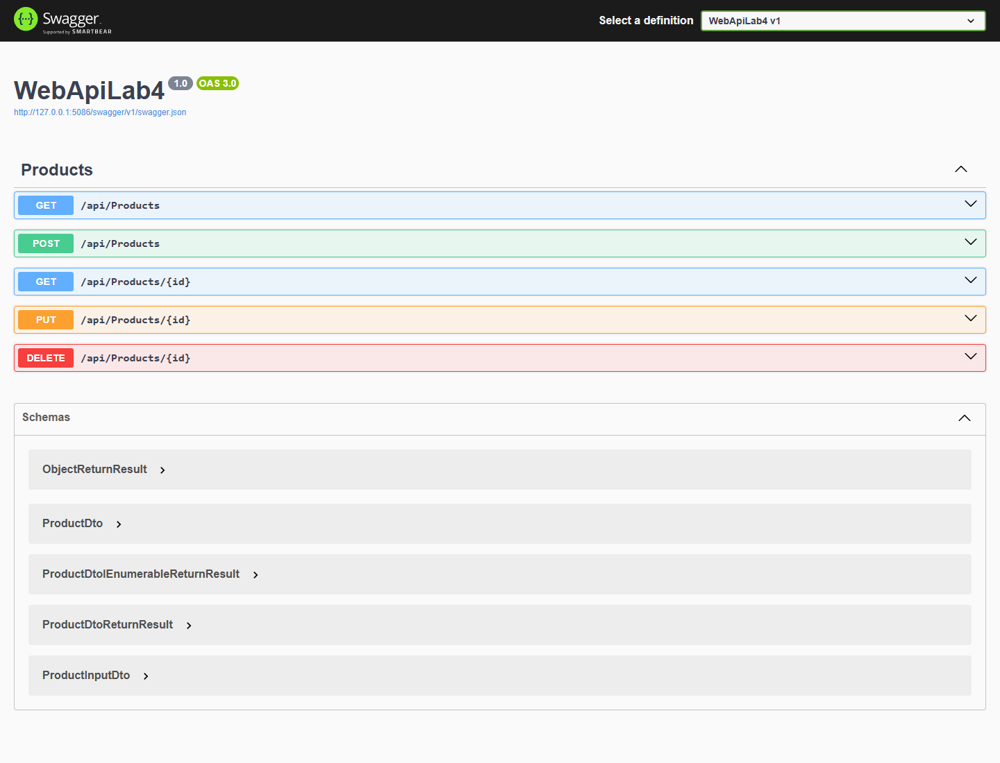
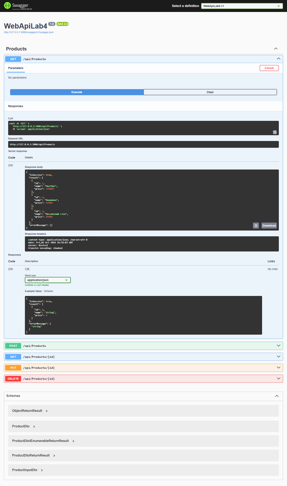
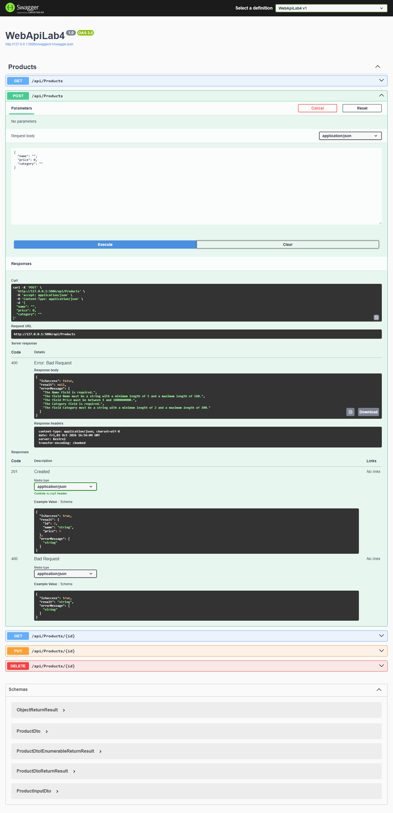
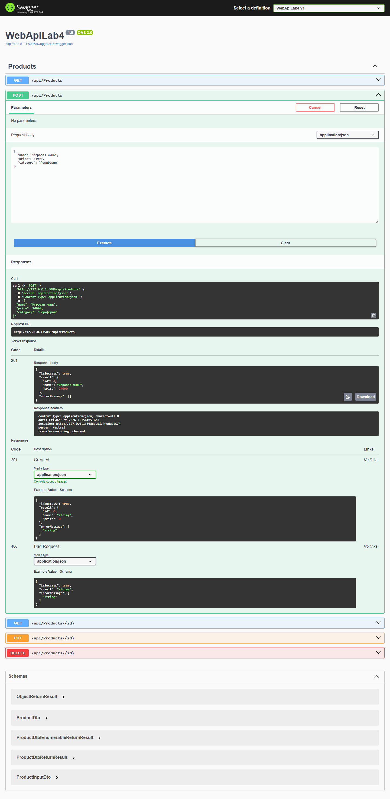
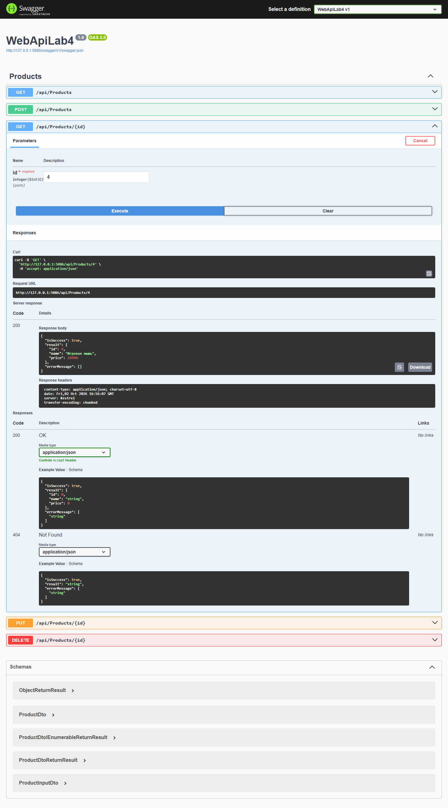
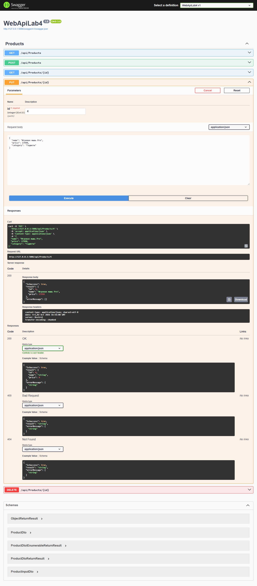
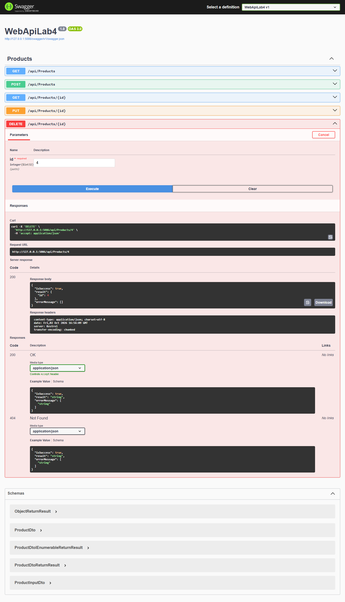
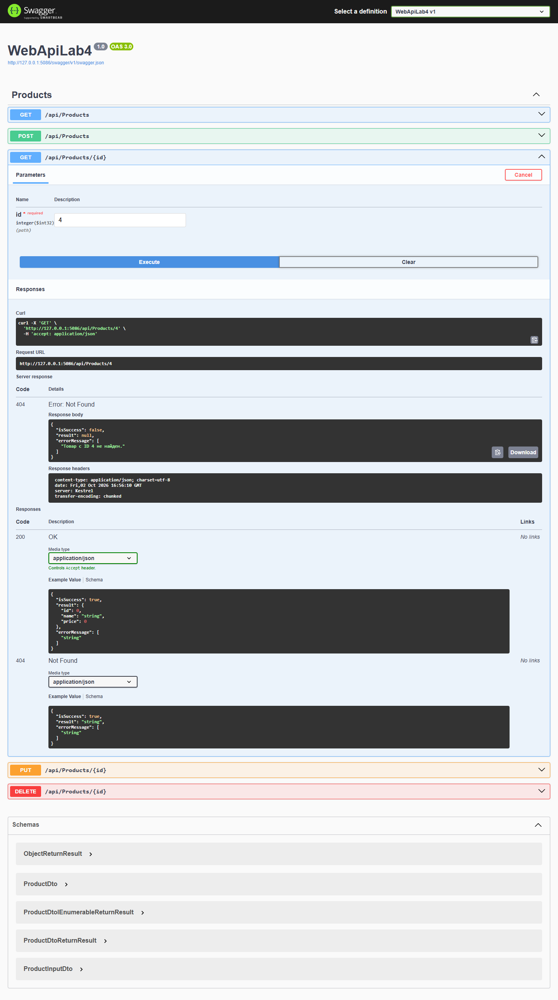
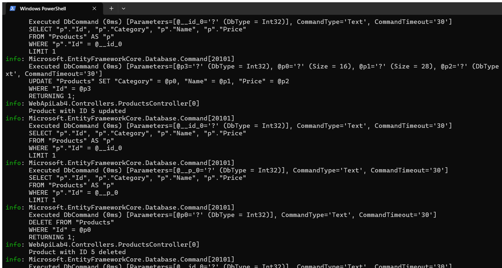

# Отчёт. Модуль 04 — Product API: DTO, AutoMapper, Repository и EF Core

**Некоммерческое АО «Казахский национальный исследовательский технический университет имени К.И. Сатпаева»**  
Институт Автоматики и информационных технологий · Кафедра Программной инженерии  
CSE5032 «Разработка веб-сервисов» · Самостоятельная работа студентов с преподавателем  
Зав. кафедры ПИ: Абдолдина Ф. Н. · Экзаменатор: Герцен Е. А.

**Тема:** создание Web API для управления товарами с использованием EF Core, Code First, Repository, DTO и AutoMapper.

## Цель и краткий отчёт

Цель работы — научиться отделять API от доступа к данным и преобразовывать сущности базы в DTO. Создано ASP.NET Core Web API `WebApiLab4` на стандартном шаблоне с контроллерами и Swagger. Данные сохраняются в SQLite; схема создаётся и обновляется миграцией EF Core. CRUD-запросы проходят через `IProductRepository`, а клиент получает единый контракт `ReturnResult<T>`.

В `Product` есть `Id`, `Name`, `Price`, `Category`. В соответствии с условием `ProductDto` намеренно содержит только `Id`, `Name`, `Price`: категория остаётся во внутренней модели и не передаётся в ответах. Для POST и PUT добавлен отдельный входной `ProductInputDto` с категорией, чтобы она могла сохраняться при записи.

## Архитектура

```text
Клиент / Swagger
      ↓
ProductsController
      ↓  IMapper
ProductInputDto ↔ ProductDto
      ↓  IProductRepository
ProductRepository
      ↓
AppDbContext / DbSet<Product>
      ↓  EF Core + миграции
SQLite (products.db)
```

| Компонент | Назначение в проекте |
| --- | --- |
| `Product` | Entity товара, сохраняемая в таблицу `Products`; включает внутреннее поле `Category`. |
| `ProductDto` | Контракт чтения для API: только `Id`, `Name`, `Price`; не раскрывает `Category`. |
| `ProductInputDto` | Входные поля POST/PUT, включая категорию, с проверкой обязательных значений и диапазона цены. |
| `AppDbContext` | Контекст EF Core и `DbSet<Product> Products`; описывает конфигурацию и начальные записи. |
| `IProductRepository` / `ProductRepository` | Репозиторий изолирует запросы и сохранение; контроллер не обращается к `AppDbContext` напрямую. |
| `AutoMapperProfile` | Содержит требуемый `CreateMap<Product, ProductDto>().ReverseMap()` и отображение входного DTO в Entity. Свойства не копируются вручную в контроллере. |
| `ReturnResult<T>` | Единая оболочка ответа: `isSuccess`, `result`, `errorMessage`. HTTP-коды при этом сохраняются: например, `201`, `400` и `404`. |

## Пошаговое выполнение

1. Создан ASP.NET Core Web API проект с контроллером и Swagger.
2. Добавлена Entity `Product`; ограничения задают обязательные имя и категорию, длину строк и положительную цену.
3. Создан `AppDbContext` с `DbSet<Product>` и настройкой точности `Price`. Строка SQLite находится в `appsettings.json` (`ConnectionStrings:DefaultConnection`).
4. Создана миграция `InitialCreate`; она создаёт таблицу `Products` и добавляет три демонстрационные записи. Миграция применяется при старте через `Database.Migrate()`.
5. Созданы `IProductRepository` и `ProductRepository` с асинхронными методами получения списка, поиска по ID, создания, изменения и удаления.
6. Добавлены `ProductDto` и входной `ProductInputDto`. `Category` отсутствует в DTO ответа — это проверяется в ответах Swagger.
7. Зарегистрированы SQLite `AppDbContext`, scoped-репозиторий и AutoMapper в `Program.cs`; профиль настроен через `CreateMap<Product, ProductDto>().ReverseMap()`.
8. В `ProductsController` реализованы пять заданных маршрутов. Все обращения к данным выполняются через репозиторий, преобразование — через AutoMapper.
9. В Swagger выполнены GET списка, POST с некорректными и корректными данными, GET по ID, PUT, DELETE и GET удалённого ID. Ответы и SQL-логи сохранены в `docs/`.

Для повторного запуска из папки проекта:

```powershell
dotnet run --urls http://127.0.0.1:5086
```

Swagger UI: `http://127.0.0.1:5086/swagger`.

## Endpoint и HTTP-результаты

| Метод | Маршрут | Назначение | Фактически проверено |
| --- | --- | --- | --- |
| `GET` | `/api/products` | Получить список товаров | `200 OK` |
| `GET` | `/api/products/{id}` | Получить товар по ID | `200 OK`; отсутствующий ID — `404 Not Found` |
| `POST` | `/api/products` | Создать товар | `201 Created`; невалидные поля — `400 Bad Request` |
| `PUT` | `/api/products/{id}` | Обновить товар по ID | `200 OK`; отсутствующий ID — `404 Not Found` |
| `DELETE` | `/api/products/{id}` | Удалить товар по ID | `200 OK`; отсутствующий ID — `404 Not Found` |

## Примеры JSON

Тело POST/PUT включает категорию, необходимую Entity и базе:

```json
{
  "name": "Игровая мышь",
  "price": 24990,
  "category": "Периферия"
}
```

Успешный ответ API использует заданный единый контракт. Поле `category` намеренно не возвращается:

```json
{
  "isSuccess": true,
  "result": {
    "id": 4,
    "name": "Игровая мышь",
    "price": 24990
  },
  "errorMessage": []
}
```

Для ошибки валидации API возвращает HTTP `400` и тот же формат с `isSuccess: false`, `result: null` и текстами ошибок в `errorMessage`.

## Скриншоты Swagger

Каждый снимок ниже сделан в Swagger UI после нажатия **Try it out** и **Execute**. Для каждого запроса сохранён отдельный файл.

### Маршруты API в Swagger



### 1. Получение списка — GET 200



### 2. Проверка валидации — POST 400



### 3. Создание товара — POST 201



### 4. Получение созданного товара — GET 200



### 5. Изменение товара — PUT 200



### 6. Удаление товара — DELETE 200



### 7. Проверка после удаления — GET 404



### Логи EF Core в PowerShell



## Вывод

Разработан Web API для управления товарами по заданной цепочке Database → EF Core → Repository → AutoMapper → DTO → Controller → API Response. Code First-миграция создаёт базу, репозиторий изолирует доступ к ней, а DTO скрывает `Category` от клиента. В Swagger проверен полный CRUD, валидация `400` и `404` для удалённого товара; HTTP status codes не подменяются единым телом ответа.
